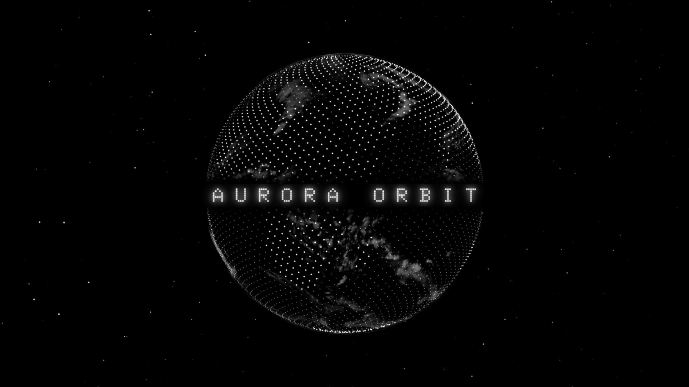
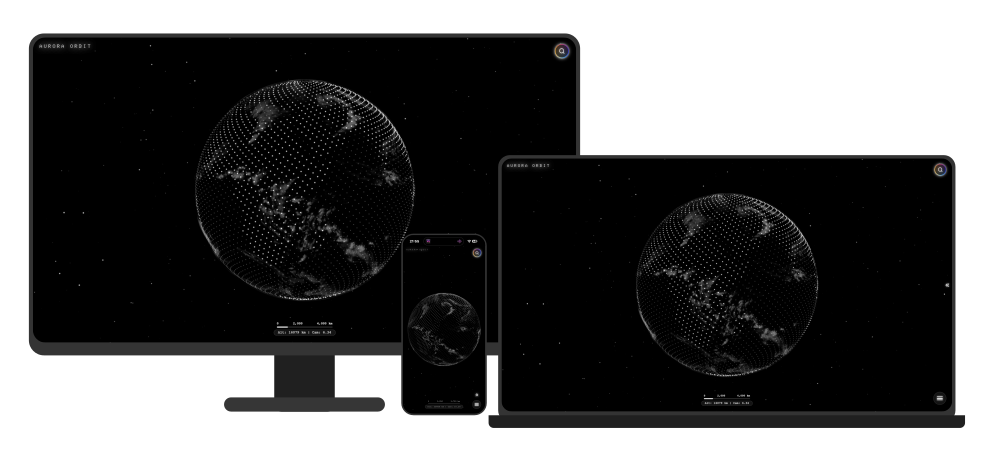
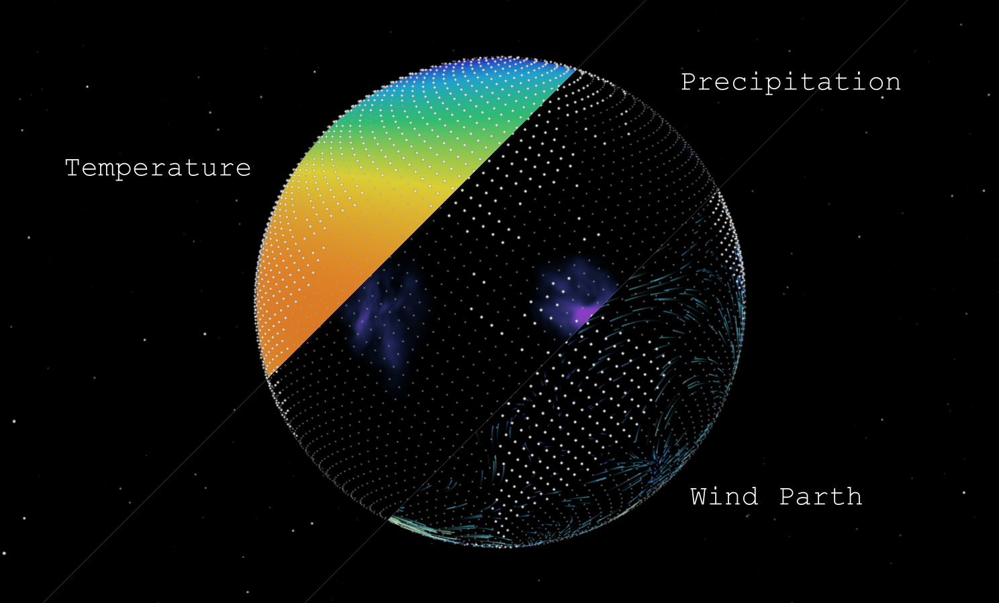
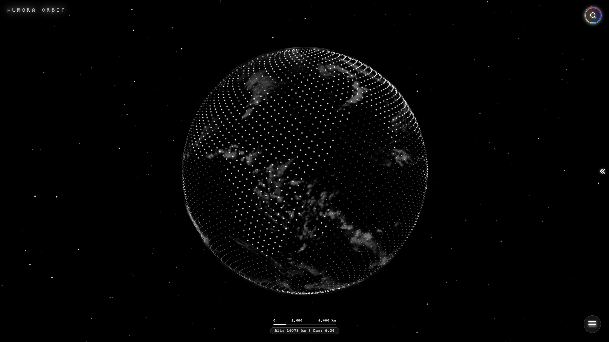
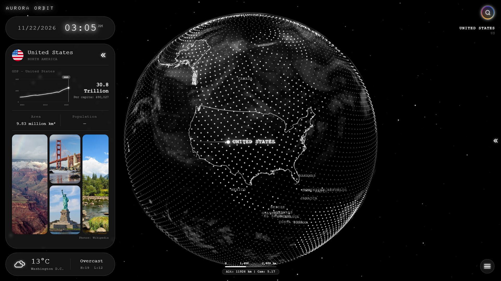
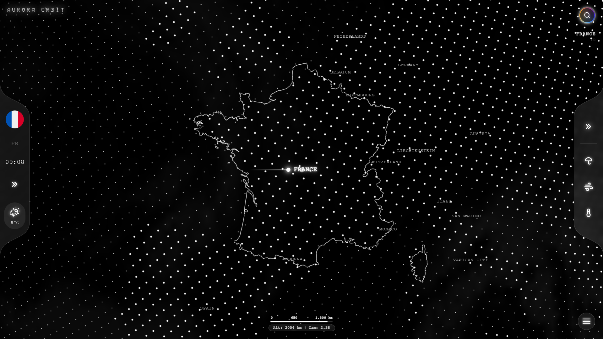
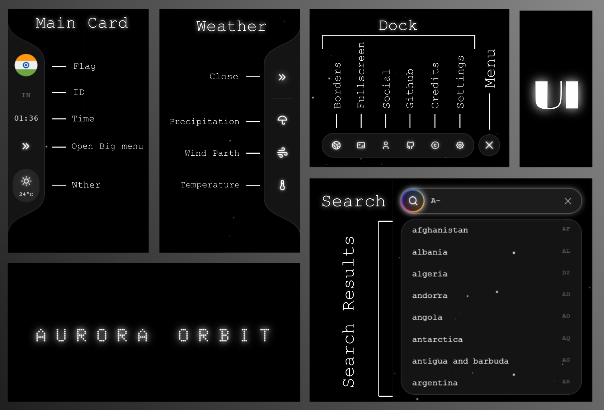

# Aurora Orbit

**Visit Aurora Orbit** - [**Aurora Orbit**](https://binupax6699.github.io/Aurora-Orbit/)

## Project info
this is a web app to exploring countries and weather and much more info. 
this is my first web app project so there can be some issues, so feel free to give feedback improve this even more.

## Supported 
this web app is Supported  for every devices and it works soomthly

## Weather

this is real time so I use API for the Wind and Precipitation and also if its offline there will be an non real for all 3

## Screenshots

<table>
<td></td>
<td></td>
<td></td>
</table>

## UI info and Buttons

<td></td>

click a country or search up using the search bar.
there is a menu button and you can change the settings and sum more stuff

## Credits
- **Three.js** - MIT License [threejs.org](https://threejs.org)
- **Circle Flags** by Hat Scripts - MIT License [github.com/HatScripts/circle-flags](https://github.com/HatScripts/circle-flags)
- **Weather Icons** by Erik Flowers - SIL OFL 1.1 [github.com/erikflowers/weather-icons](https://github.com/erikflowers/weather-icons)
- **Weather data** by Open-Meteo.com - CC BY 4.0 [open-meteo.com](https://open-meteo.com)
- **Economic data** by World Bank - CC BY 4.0 [data.worldbank.org](https://data.worldbank.org)
- **Country data** by REST Countries [restcountries.com](https://restcountries.com)
- **Borders** by Natural Earth - public domain [naturalearthdata.com](https://www.naturalearthdata.com)
- **Photos** by Wikimedia Commons [commons.wikimedia.org](https://commons.wikimedia.org)

## AI 
This is my fest web app that I make and I use lot of Ai for this.
To learn and to see how it can done, so in sum parts I use Ai a lot and sum parts written by me that I learn from Ai and sum tutorials.
And I use Ai for cool fetchers to have in this web app.
And I need a working thing that any one will love
lot of AI was use for to make the APIs, make it optimize, work great and and importantly to learn 

**Made with love and care ❤️**
